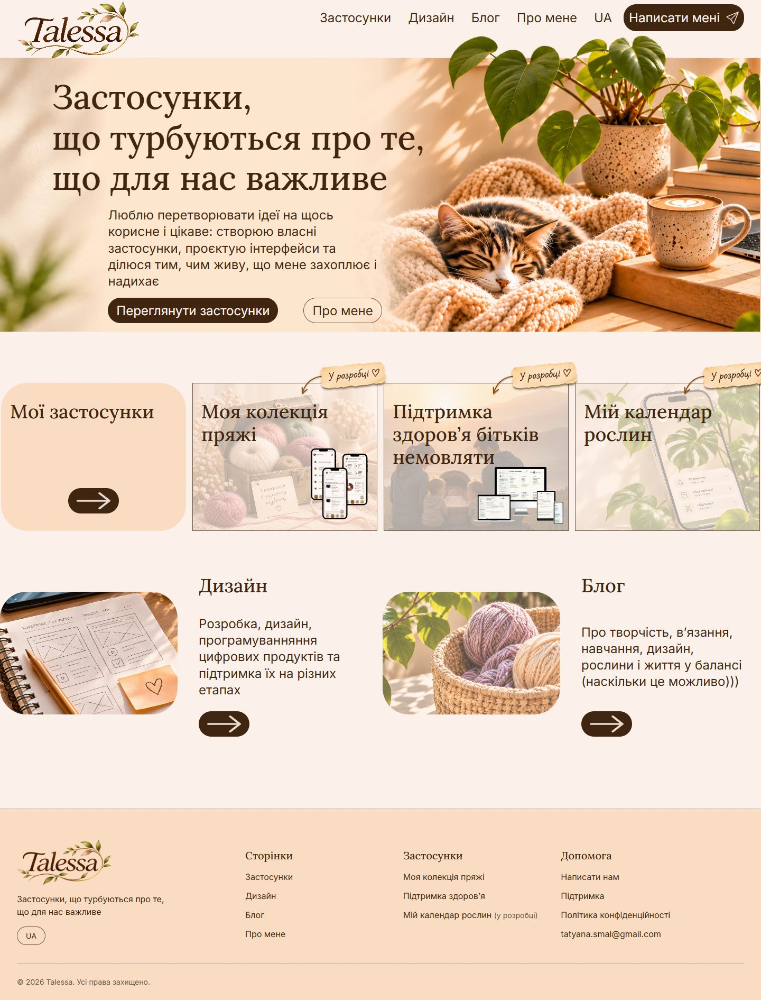
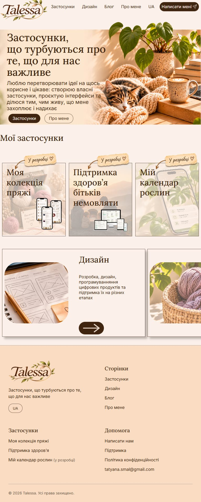
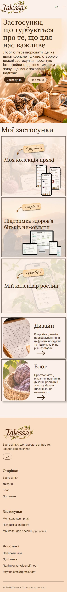
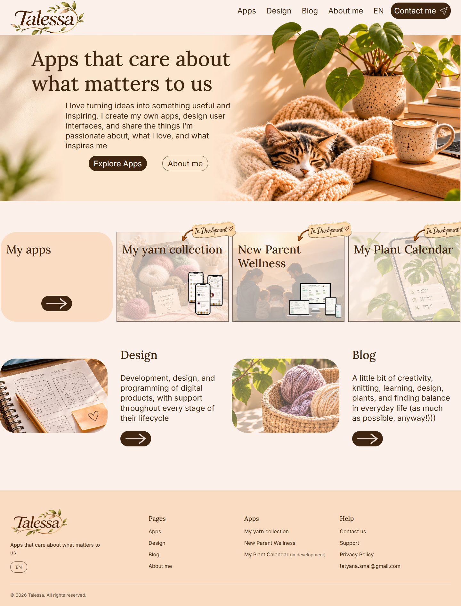
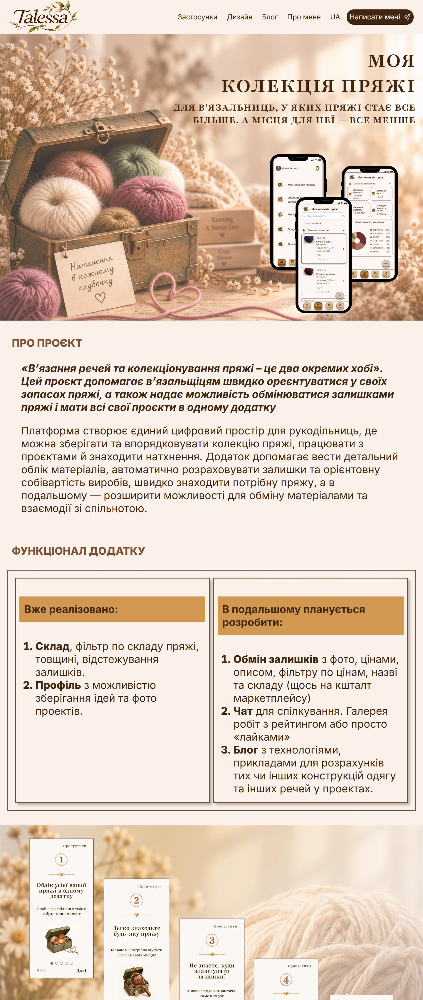
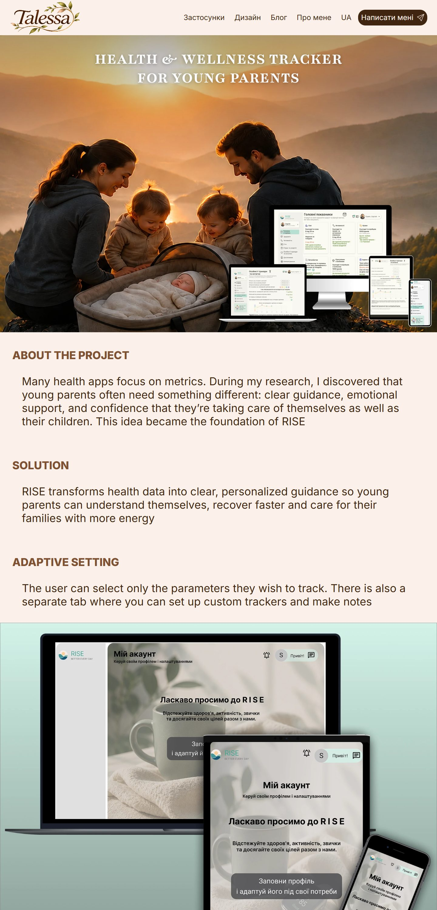

# Talessa — сайт-портфоліо

**Талесса (Talessa)** — застосунки, що турбуються про те, що для нас важливе.
Це сайт-портфоліо розробниці й дизайнерки застосунків: на ньому зібрано її проєкти, блог та сторінки, потрібні для публікації застосунків у Google Play та App Store.

**Опублікована версія:** https://talessa-phi.vercel.app/

> Проєкт створено за макетами у Figma («HW-1 Site First screen»). Сайт має українську та англійську версії.

## Скриншоти

| Десктоп | Планшет | Телефон |
| --- | --- | --- |
|  |  |  |

**Англійська версія головної:**



**Сторінки застосунків:**

| «Моя колекція пряжі» | «Підтримка здоров’я» (RISE) |
| --- | --- |
|  |  |

## Функціональність

- **Головна сторінка:** позиціювання, перший екран, картки застосунків зі статусом «У розробці», блоки «Дизайн» і «Блог».
- **Сторінка «Моя колекція пряжі»** (`/my-yarn`): опис проєкту, функціонал, екрани реєстрації, каталогу та фільтрів, версії для Android і iOS, нічний режим.
- **Сторінка «Підтримка здоров’я батьків» (RISE)** (`/health`): кейс про трекер здоров’я для молодих батьків (поки англійською).
- **Підвал на кожній сторінці:** навігація, сторінки застосунків, посилання на «Підтримку» та «Політику конфіденційності», email.
- **Політика конфіденційності** (`/privacy`) і **Підтримка** (`/support`) двома мовами. Політика має окремий розділ на кожен застосунок з якорями (`/privacy#my-yarn`, `/privacy#rise`), підтримка — розділ про видалення акаунта (`/support#delete-account`). Це робочі чернетки, їх треба перевірити перед публікацією застосунків у магазинах.
- **Форма зворотного зв’язку** (`/contact`, кнопка «Написати мені»): імʼя, email, тема, повідомлення, згода на обробку даних, захист від ботів (прихована пастка). Для доставки листів потрібен безкоштовний ключ [Web3Forms](https://web3forms.com): змінна `VITE_WEB3FORMS_KEY` (див. `.env.example`). Без ключа форма відкриває поштовий застосунок відвідувача з готовим листом.
- **Дві мови:** перемикач UA/EN у шапці, вибір запам’ятовується, змінюється `lang` документа. Перекладено головну та «Моя колекція пряжі».
- **Адаптивність:** окремі розкладки для десктопа (від 1101 px), планшета (601–1100 px) та телефона (до 600 px). Головне зображення сторінки масштабується разом із текстом як єдине ціле.
- **Мобільне меню** (бургер): закривається при натисканні поза меню та клавішею Esc.
- **Світла тема:** сайт примусово світлий, щоб вбудовані браузери (наприклад, Telegram) не затемнювали його автоматично. Темна версія — у планах.

## Технології

- [React](https://react.dev/) 19 + [TypeScript](https://www.typescriptlang.org/)
- [Vite](https://vite.dev/) — збірка та dev-сервер
- [React Router](https://reactrouter.com/) — сторінки `/`, `/my-yarn`, `/health`
- Чистий CSS (змінні, `clamp()`, container query units `cqw` для масштабування головного екрана)
- [oxlint](https://oxc.rs/) — лінтер
- Публікація на [Vercel](https://vercel.com/) (автоматичний деплой після кожного push у `main`)

## Запуск локально

Потрібен [Node.js](https://nodejs.org/) (LTS).

```bash
npm install
npm run dev      # dev-сервер: http://localhost:5173
npm run build    # перевірка типів і production-збірка у dist/
npm run preview  # локальний перегляд зібраної версії
npm run lint     # лінтер
```

## Структура проєкту

```text
src/
  components/    Header (меню, перемикач мови), Footer (підвал), Rich (жирний текст і посилання в перекладах)
  pages/         Home, MyYarn, Health, Privacy, Support, Contact (і їхні стилі)
  i18n/          перемикач мови та тексти: strings.ts, yarnStrings.ts, legalStrings.ts, contactStrings.ts
  index.css      дизайн-токени (кольори за ролями, шрифти, відступи, радіуси, пропорції)
  config.ts      публічний email, назва розробника, дата редакції політики
  assets/img/    зображення (hero, картки, мокапи, сторінки застосунків)
  App.tsx        маршрути
  App.css        стилі головної (десктоп, планшет, телефон)
docs/
  Чернетка плану сайту.md   план сайту й наступні кроки
  design-tokens.md          дизайн-система: токени, контраст, що не ввійшло в набір
  screenshots/              скриншоти для цього README
vercel.json      перенаправлення на index.html (SPA)
```

## Переклади

Усі тексти лежать у словниках за мовами, поруч українські й англійські:

- `src/i18n/strings.ts` — шапка та головна сторінка;
- `src/i18n/yarnStrings.ts` — сторінка «Моя колекція пряжі»;
- `src/i18n/legalStrings.ts` — політика конфіденційності та підтримка.

Щоб додати текст, достатньо дописати його в обох мовах і використати у компоненті.

## Плани

План сайту й наступні кроки: [docs/Чернетка плану сайту.md](docs/Чернетка%20плану%20сайту.md). Серед них: темна версія, переклад решти сторінок, власний домен, окрема пошта проєкту замість особистої, умови використання для платної підписки.

---

## English summary

**Talessa** is a portfolio site for apps that care about what matters to us. It is a Vite + React + TypeScript single-page app with Ukrainian and English versions, responsive layouts for desktop, tablet and mobile, and case pages for the apps *My yarn collection* and *New Parent Wellness (RISE)*.

Live site: https://talessa-phi.vercel.app/ · Run locally: `npm install && npm run dev`.
